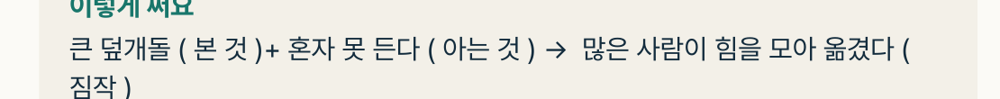

# 수업 화면 PPTX 생성기

차시 명세의 `slides` 에서 수업 화면 PPTX(13.333 × 7.5in)를 만듭니다. 웹의 수업 화면(`/<id>/slides/`)과 같은 자료, 같은 짜임입니다.

```
node generators/pptx/build.mjs                       # 이번 빌드에 실리는 묶음 전부 → dist/files/<id>/slides.pptx
node generators/pptx/build.mjs --only 5-2/1/01        # 한 묶음만
node generators/pptx/build.mjs --out .cache/tests/x   # 다른 dist 폴더 (캐시는 .cache/tests/x.cache/)
```

- Python 은 환경 변수 `PYTHON` 이 있으면 그것을, 없으면 `python3` 을 씁니다. 필요한 패키지는 `requirements.txt` 에 있습니다 (`python-pptx`. Pillow 와 lxml 은 함께 깔립니다).
- SVG 그림은 Chromium(Playwright)으로 폭 1600px PNG 로 바꿔 `.cache/media/<id>/` 에 둡니다. `CHROMIUM_PATH` 를 따릅니다.
- 다시 만들지 않아도 되는 묶음은 `.cache/files/<id>/slides.pptx` 를 복사만 합니다. 그 묶음의 `lessons.json` 항목, 거기 적힌 그림 파일, 이 폴더의 파일, `package-lock.json` 이 같으면 다시 만들지 않습니다.
- 글이 한 장을 넘칠 것 같으면 어느 묶음의 몇 번 장인지 적고 멈춥니다. 형식이 허락하는 가장 긴 글까지는 넘치지 않습니다 (`tests/slides/` 가 봅니다).

## 파일

| 파일 | 하는 일 |
|---|---|
| `build.mjs` | 명세를 `.cache/lessons.json` 으로 내보내고, SVG 를 PNG 로 바꾸고, Python 을 부르고, 캐시와 dist 에 놓습니다 |
| `build_pptx.py` | `lessons.json` 만 읽고 장을 그립니다. 웹 무대(`src/components/slides/stage.css`)와 같은 1920 × 1080 px 자리에 놓습니다 (1px = 0.5pt) |
| `ttf.py` | 글꼴 파일에서 글자 폭을 읽어 줄바꿈을 미리 셉니다. PowerPoint 에 심을 EOT 꼴도 만듭니다 |
| `embed.py` | Pretendard 보통·굵게와 장 번호의 Pretendard Medium, 세 벌을 통째로 PPTX 에 심습니다 (글꼴이 없는 학교 컴퓨터에서도 같은 모양) |

## 만들어지는 PPTX

- 명세의 슬라이드 한 장이 PPTX 한 장입니다. 번호가 `flow.slides` 와 같습니다.
- 장의 둘레는 웹 무대와 같습니다 (R55, `src/components/slides/counter.ts` 의 `slideFrame()`).
  - 모든 장(표지와 그림 출처 장까지)의 왼쪽 아래에 바닥글 줄 `stageFooter(lesson)`: `nalssam의 초등사회콘텐츠 클라우드  |  5학년 2학기 1단원 1차시  |  ` 다음에 AI 사용 표시나 초안 표시. 12pt(무대 24px) 회색, 줄을 바꾸지 않습니다. 한 줄에 들어가지 않으면 멈춥니다.
  - 오른쪽 아래에 두 자리로 채운 장 번호 `05 / 22`(두 차시 묶음은 차시마다 세어 `3차시 01 / 04`). 바닥글 줄과 같은 크기, 같은 줄이고 글꼴은 Pretendard Medium 입니다. 표지(두 차시 묶음의 둘째 표지도)와 그림 출처 장에는 없습니다. 그래서 분모가 늘 수업 화면의 장 수입니다.
  - 제 머리말이 없는 장(그림, 항목, 견주기, 단계, 읽기 자료, 활동)의 제목 위에 흐름 단계 머리말 `01 도입`(`slidePhase()`): 15pt(무대 30px) 청록 굵게. 머리말은 위 여백 안(무대 40~76)에 놓여 제목은 머리말이 없는 장과 같은 자리(무대 80)에서 시작합니다. 그래서 머리말 때문에 본문 자리가 줄지 않습니다 (`STAGE_PHASE`).
- 글은 모두 고칠 수 있는 글상자입니다. 줄 간격은 고정값입니다. 글자 크기를 줄이는 자동 맞춤은 쓰지 않습니다. 낱말 장의 '이렇게 써요' 상자만 글에 맞춰 상자가 늘어납니다 (다른 글꼴로 열어 줄이 늘어도 글이 상자 밖으로 나가지 않게).
- 그림 없는 항목 장, 견주기 장, 활동 장, 그림 있는 단계 장의 글은 크게 쓰고 넘치면 한 단계씩 줄입니다 (`STAGE_FIT`). 웹 무대와 같은 크기 차례를 씁니다. 그림 틀의 짧은 변이 200px(`STAGE_PICTURE.shortSide`)보다 작아지면 넘친 것으로 셉니다.
- 그림이 넷인 단계 장은 2 × 2 로 놓습니다 (R22). 칸마다 위에 머리 한 줄(단계 표와 단계 글, 같은 크기로 44px 또는 40px), 그 아래에 칸 폭 전체를 쓰는 그림 상자가 있고 그림은 상자 안 가운데에 놓입니다. 머리가 두 줄을 넘거나 그림 상자가 너무 작아지는 아주 긴 글만 한 줄(4칸)로 놓습니다. 단계 그림의 출처 표시가 모두 같으면 목록 아래에 한 번만 찍습니다.
- 견주기 장 (R23): 쪽마다 그림이 있으면 두 그림 상자의 높이가 같고 그림과 출처 표시는 상자 아래 끝에 붙습니다. 그래서 두 쪽의 출처 표시와 첫 항목이 같은 높이에 섭니다. 두 쪽이 함께 보는 그림 하나(`media`)는 글 곁에 그림 하나를 두는 두 칸 짜임입니다 (왼쪽에 이름표 상자 둘을 위아래로, 오른쪽에 그림).
- 사진(`kind: photo`)에는 `--line` 색의 0.5pt 선을 두릅니다 (R26. 무대의 1px 테두리와 같은 굵기). 도해·지도·그림에는 두르지 않습니다.
- 글 조각(run)과 문단 끝(`endParaRPr`)마다 `lang="ko-KR"`, `altLang="en-US"` 를 적습니다 (메모란과 도형의 빈 문단도). PowerPoint 가 영어 맞춤법 검사로 한글에 밑줄을 긋지 않게 하려는 것입니다.
- 1번 장(표지)에는 단원·차시·교과서 쪽(`coverText().meta`)을 찍습니다. AI 사용 표시나 초안 표시는 모든 장과 같이 바닥글 줄에 있습니다.
- 파일 정보(`docProps/core.xml`): 제목 `<차시 제목> 수업 화면`(초안은 앞에 `[검수 전 초안] `), 만든 이·마지막으로 고친 이 `SITE.author`, 키워드 `CC BY-NC-SA 4.0`, 판 1. 날짜는 공개된 차시는 승인한 날, 초안은 2026-01-01 로 고정합니다 (빌드할 때마다 파일이 달라지지 않게). `docProps/app.xml` 에는 장 수만 적고, 화면 크기에 4:3 이름(`type="screen4x3"`)을 남기지 않습니다.
- 메모란은 `slideNotes(lesson, no)` 입니다. 퀴즈 장은 그 뒤에 `정답: …`, `풀이: …` 두 줄이 붙습니다 (화면에는 정답을 찍지 않습니다). 메모가 없는 장은 웹 무대의 메모 창과 같은 `NOTE_COPY.empty` 한 줄을, 그림 출처 장은 `CREDIT_COPY.notes`(그림이 없으면 `notesEmpty`)를 적습니다. 메모란이 빈 장은 없습니다 (`tests/pptx/` 가 봅니다).
- 마지막 장은 '그림 출처'입니다: `creditList(shownMedia(lesson, 'slides'))` 와 그 주소, 맨 아래 `sheetFooter(lesson)`. 초안의 `sheetFooter` 는 초안 표시뿐이고 바닥글 줄의 끝과 글자까지 같으므로 따로 찍지 않습니다 (한 장에 같은 글이 두 번 서지 않게). 수업 중에 띄우는 장이라 그림 제목은 넣지 않고, 같은 출처는 `그림 5장: …` 처럼 한 줄로 묶습니다. 길면 앞 장을 실제 자리만큼 채운 뒤에 다음 장을 엽니다 (앞 장에 들어갈 한 줄만 따로 남은 장을 만들지 않습니다).
- 그림은 원본 비율 그대로 틀 안에 넣습니다. 자르기 값을 쓰지 않습니다. 그림 바로 아래에 `creditShort()` 를 찍습니다.
- 색은 `src/styles/tokens.css` 의 것만 씁니다 (`lessons.json` 으로 넘어옵니다).

## LibreOffice 로 열 때

LibreOffice Impress 는 한글과 로마자·숫자·문장 부호 사이에 조금 넓은 틈을 둡니다 (Impress 의 문단 설정 '아시아 문자와 비아시아 문자 사이 간격'). PPTX(DrawingML)에는 이 간격을 끄는 속성이 없어서 파일 쪽에서 막을 수 없습니다. 파일의 글은 그대로이고, 웹 무대에는 이 틈이 없습니다. 글을 고쳐 틈을 메우지 않습니다. 아래는 LibreOffice 로 PDF 를 찍은 낱말 장입니다 (`( 본 것 )+`, `( 아는 것 )` 의 괄호 앞뒤).



글 조각에 `lang="ko-KR"` 을 적은 뒤에도 이 틈은 그대로입니다. 같은 글 여섯 줄을 언어를 적은 파일과 적지 않은 파일로 만들어 LibreOffice 로 찍고 줄 폭을 재어 보았더니 여섯 줄 모두 소수 첫째 자리까지 같았습니다. 언어 표시와 관계없는, LibreOffice 가 그리는 방식의 문제입니다. PowerPoint 와 한컴 한쇼에서 어떻게 보이는지는 날쌤이 실제 컴퓨터에서 확인합니다 (`docs/ROADMAP.md`).

줄바꿈은 이 틈까지 넣어 셉니다: 한글과 다른 글자가 맞닿을 때마다(띄어쓰기는 건너뛰고) 글자 크기의 0.25배를 더합니다 (`ASIAN_GAP`. 26pt 로 찍어 재어 보니 0.24배 남짓이었습니다). 그 밖에는 글꼴 파일의 글자 폭 그대로이고, 상자 폭은 99% 까지 씁니다 (`FIT`). 예전처럼 95% 만 쓰면 한 줄에 들어가는 항목이 두 줄짜리 상자를 받아 항목 사이가 들쭉날쭉했습니다 (실제 차시 8번 장). 넘침 시험(`tests/slides/pptx.test.ts`)은 LibreOffice 로 찍은 글이 글상자 안에 있는지, 한 줄짜리 항목 사이가 고른지를 봅니다.

## `.cache/lessons.json`

`build.mjs` 가 쓰고 `build_pptx.py` 만 읽습니다. 다른 담당은 읽지 않습니다. 화면에 찍히는 글은 모두 여기에 실려 있어서 Python 쪽에는 문구가 없습니다.

```jsonc
{
  "version": 1,
  "colors": { "bg": "FBFAF6", "card": "FFFFFF", "navy": "132C3D", "teal": "18766B", "teal-soft": "E3F0EC", "coral": "D9734E", … }, // tokens.css 의 색 전부 (# 없이 대문자)
  "fonts": { "name": "Pretendard", "regular": "<절대 경로>/Pretendard-Regular.ttf", "bold": "<절대 경로>/Pretendard-Bold.ttf",
             "mediumName": "Pretendard Medium", "medium": "<절대 경로>/Pretendard-Medium.ttf" },   // 장 번호는 Pretendard Medium (R55)
  "type": { "cover": 104, "title": 72, "body": 44, "footer": 24, "counter": 24, "phase": 30, … }, // 글자 크기 px (src/components/slides/copy.ts 의 STAGE_TYPE)
  "phase": { "top": 40, "lineHeight": 1.2, "gap": 4 },           // 단계 머리말이 있는 장의 머리 (STAGE_PHASE, R55)
  "fit": { "points": [56, 52, 48, 44], … },                      // 장에 맞게 줄어드는 글의 크기 차례 (STAGE_FIT)
  "picture": { "compareMin": 360, "shortSide": 200 },            // 그림 틀의 크기 (STAGE_PICTURE)
  "side": { "gap": 72, "maxLines": { "points": 2, "question": 3, "compare": 2 }, // 글 곁에 그림 하나를 두는 장 (STAGE_SIDE, R12)
            "candidates": { "points": [[1120, 48], [1008, 48], …], "question": [[1120, 80], …], "compare": [[1120, 48], …] } }, // 해 볼 [그림 칸 폭, 글 크기] 차례 (sideCandidates)
  "steps": { "gridFit": [44, 40], "maxLines": 2 },               // 2 × 2 단계 장의 머리 글 크기 차례와 줄 수 (STAGE_STEPS, R22)
  "copy": { "slide": { "term": "새 낱말", "quiz": "확인 퀴즈", … } }, // 장 안의 이름표 (SLIDE_COPY)
  "lessons": [
    {
      "id": "5-2/1/01",
      "title": "…",
      "pptx": "<절대 경로>/.cache/files/5-2/1/01/slides.pptx",      // Python 이 쓰는 자리. build.mjs 가 dist 로 복사한다
      "cover": { "meta": "단원명 · 1차시 · 교과서 6~9쪽" },
      "stageFooter": "nalssam의 초등사회콘텐츠 클라우드  |  5학년 2학기 1단원 1차시  |  …", // 모든 장의 바닥글 줄 (stageFooter, R55)
      "doc": { "title": "[검수 전 초안] … 수업 화면", "author": "SITE.author", "keywords": "CC BY-NC-SA 4.0", "date": "2026-01-01T00:00:00Z" },
      "slides": [ /* 아래 */ ],
      "credits": {
        "heading": "그림 출처", "empty": "…", "more": "({n}/{total})",
        "items": [ { "text": "creditList() 의 text", "sourceUrl": "…", "licenceUrl": "…" } ],
        "footer": "sheetFooter(lesson)",                             // 초안은 null (바닥글 줄의 끝과 같은 글이라 두 번 찍지 않는다)
        "notes": ["CREDIT_COPY.notes 또는 notesEmpty"]               // 출처 장의 메모란
      }
    }
  ]
}
```

장마다 `no`(1부터), `layout`, `notes`(메모란 줄들. 비어 있지 않다), `counter`(장 번호 글 `slideCounter()`. 표지는 null), `phase`(단계 머리말 `slidePhase().kicker`. 제 머리말이 있는 장이나 어느 단계에도 들지 않는 장은 null)가 있고, layout 에 따라 아래 칸이 더 있습니다. 그림(`media`)은 `{ "id": "5-2/1/01/stone", "file": "<절대 경로: jpg·png, SVG 는 바꾼 PNG>", "alt": "…", "credit": "creditShort()", "kind": "photo" }` 입니다 (`kind` 는 명세의 그림 종류. 사진에만 테두리를 두른다).

| layout | 칸 |
|---|---|
| `title` | `title`, `subtitle?`, `kicker`(학기·단원), `first`(1번 장인가. 1번 장만 `cover` 의 글을 찍는다) |
| `question` | `kicker?`, `title`, `hint?`, `media?` |
| `picture` | `title`, `caption?`, `media` |
| `points` | `title`, `points[]`, `media?` |
| `compare` | `title`, `media?`(두 쪽이 함께 보는 그림), `left`·`right`: `{ label, points[], media? }` |
| `steps` | `title`, `steps[]`: `{ label, text, media? }` |
| `term` | `term`, `meaning`(termMeaning), `example?` |
| `passage` | `passage`: `{ title, text[], source }` |
| `activity` | `title`, `instructions[]`, `minutes?`, `materials[]` |
| `quiz` | `quiz`: `{ type: ox·choice·short, q, choices? }` (정답은 `notes` 에) |
| `closing` | `title`, `points[]` |
